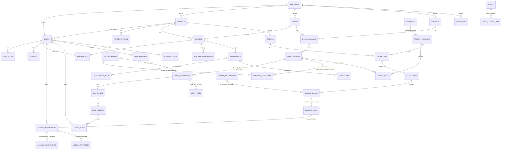
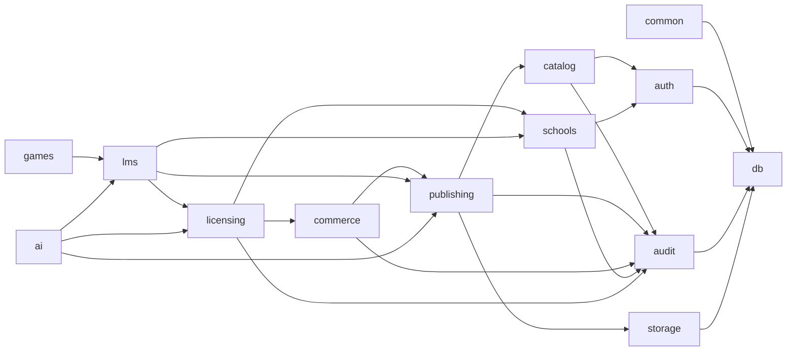

# EduBooks LMS — Architecture

> Status: **All 7 phases are implemented** — foundation, Book Package Management, products & bundles, schools, orders, the full licensing system, School Admin portal, classes, the digital reader, lesson planner, homework/quizzes/tests with marking, question bank, gradebook and report cards, the AI teaching assistant grounded in indexed book pages, the playful student portal with 10 game engines, stars and badges, and production hardening (lockout, idle sessions, CSP and headers, health checks, OCR, backups with a verified restore, a WCAG 2.1 AA audit, a load test, Docker, CI). See DEPLOYMENT.md, OPERATIONS.md and SECURITY.md.
> A clickable UX prototype of the whole idea lives in `/lms` (Node + SQLite). It's for demos only and isn't production code.

---

## 0. Key technical decisions & trade-offs

| Decision | Choice | Why / trade-off |
|---|---|---|
| Backend | **NestJS (TypeScript)**, REST, OpenAPI at `/api/docs` | Modules map 1:1 to business domains (publishing, commerce, licensing, school, LMS, AI). Heavier than Express, but it gives DI, guards and testability. |
| Data access | **Drizzle ORM + node-postgres**, hand-reviewed SQL migrations | Pure JS (no engine binaries to download). Lets us write raw SQL for RLS policies, `SECURITY DEFINER` auth functions and `SELECT … FOR UPDATE` seat allocation. Prisma would make RLS and locking awkward. |
| Database | **PostgreSQL 16** + `pgcrypto`, `citext`, `pgvector` | Transactions, row locks for licences, RLS for tenant isolation, and vectors for RAG — all in one engine. |
| Tenant isolation | **Defence in depth:** (1) guards/services always filter by tenant; (2) **PostgreSQL Row-Level Security**. The app connects as `edubooks_app` (not table owner, `NOBYPASSRLS`). Each request runs in a transaction with `app.publisher_id`, `app.school_id`, `app.user_id`, `app.role` set via `set_config(…, true)`. | A forgotten `WHERE` can't leak another school's data. Cost: every request is wrapped in a transaction (cheap for this workload). |
| Auth | Username (+ school code for school users) and password. **Argon2id** hashes. **Opaque session tokens** in an httpOnly, SameSite=Lax cookie; only a SHA-256 of the token is stored. Login is rate-limited. | Revocable instantly (suspend a school → sessions die), no JWT key management. Trade-off: one DB lookup per request, which is negligible. |
| Login before tenant context | `SECURITY DEFINER` SQL functions `auth_find_login()` and `auth_session()` | The only paths that read across tenants are two audited, narrowly-scoped functions. |
| Files | **Private S3-compatible storage** (`STORAGE_DRIVER=s3`, e.g. AWS S3, Cloudflare R2, MinIO) or a private local directory in dev. Downloads go through **short-lived HMAC-signed URLs** (default 5 min) issued only after an authorisation check. | No permanent public URLs for restricted content. |
| File de-duplication | `digital_assets` is content-addressed (SHA-256, unique per publisher). Resources *reference* assets. New editions and bundles reference the same assets. | The same PDF is never stored twice. |
| Upload safety | Extension allow-list, **magic-byte sniffing**, size limit, ClamAV scan (`CLAMAV_HOST`), HTML/SVG served with `Content-Security-Policy: sandbox` + `nosniff`. | Scanning status is stored per asset (`CLEAN / SKIPPED / INFECTED`). |
| Content immutability | A **published edition's structure is locked**. Changes go into a new edition (clone). | Licences sold against edition 2026 never silently change. |
| Commerce immutability | `product_versions` are frozen when activated. Orders reference a **version**, never a mutable product. | "Changes to a bundle must not silently alter licences already purchased." |
| Frontend | **Next.js (App Router) + React + TypeScript + Tailwind**. Radix primitives for accessible dialogs. Two themes: professional (admin/teacher) and playful (student). | `/api/*` is proxied by Next to Nest, so cookies stay same-origin (no CORS or CSRF token juggling). |
| AI | Provider abstraction (`AiProvider`: Ollama/vLLM self-hosted, OpenAI-compatible APIs, Gemini). **RAG** over `book_pages` / lesson text with pgvector. Every request is logged in `ai_generations` with tokens and cost. | Self-hosted open-weight models (e.g. Llama / Qwen on a GPU box via vLLM or Ollama) keep marginal cost low, but **GPU hosting is not free**. The abstraction lets you switch per cost. |

---

## 1. Project structure

```
edubooks/
├── package.json                # npm workspaces
├── docs/ARCHITECTURE.md
├── apps/
│   ├── api/                    # NestJS backend
│   │   ├── drizzle/            # SQL migrations (generated + hand-written RLS)
│   │   ├── src/
│   │   │   ├── main.ts
│   │   │   ├── app.module.ts
│   │   │   ├── config.ts
│   │   │   ├── db/             # drizzle schema, DbService (tenant tx via AsyncLocalStorage), migrate, seed
│   │   │   ├── common/         # guards, decorators, pipes, errors, pagination
│   │   │   ├── auth/           # login, sessions, password hashing, rate limit
│   │   │   ├── audit/          # audit log writer + query API
│   │   │   ├── storage/        # local + S3 drivers, signed URLs, scanner, file sniffing
│   │   │   ├── catalog/        # grades, subjects (publisher taxonomy)
│   │   │   ├── publishing/     # book packages, editions, components, units, lessons, pages, resources
│   │   │   ├── commerce/       # (Phase 3) products, versions, bundles, orders, fulfilment
│   │   │   ├── licensing/      # (Phase 3) pools, seats, assignments, transfers, entitlements, expiry job
│   │   │   ├── schools/        # (Phase 3/4) schools, academic years, classes, enrolments, imports
│   │   │   ├── lms/            # (Phase 4) reader progress, plans, assignments, assessments, submissions
│   │   │   ├── games/          # (Phase 6) game catalogue, lesson mapping, attempts
│   │   │   └── ai/             # (Phase 5) providers, RAG indexer, generators, usage tracking
│   │   └── test/               # e2e tests against a real PostgreSQL
│   └── web/                    # Next.js frontend
│       └── src/
│           ├── app/
│           │   ├── login/
│           │   ├── admin/      # Publisher portal (Phase 2 ✅)
│           │   ├── school/     # School admin portal (Phase 3–4)
│           │   ├── teacher/    # Teacher portal (Phase 4–5)
│           │   └── learn/      # Student portal (Phase 6, playful theme)
│           ├── components/ui/  # Button, Card, Badge, Dialog, Table, Input, …
│           └── lib/            # api client, hooks, formatters
```

---

## 2. Entity-relationship model

UUID primary keys everywhere. `publisher_id` sits on every row so RLS policies stay simple and index-friendly. `school_id` sits on every school-private row.



### Licensing rules → schema mechanics (Phase 3)
| Rule | Mechanism |
|---|---|
| Every seat traceable to an order or approved adjustment | `license_pools` has `CHECK ((fulfillment_id IS NOT NULL) <> (adjustment_id IS NOT NULL))`. |
| Never exceed purchased quantity | Seats are **materialised rows** (`license_seats`, exactly `quantity` rows generated at fulfilment). An assignment needs a free seat row. |
| No double assignment of a seat | Partial unique index `license_assignments(seat_id) WHERE status IN ('ACTIVE','SUSPENDED')`. Allocation uses `SELECT … FOR UPDATE SKIP LOCKED` inside one transaction. |
| One student holds one seat per pool | Partial unique `(pool_id, user_id) WHERE status IN ('ACTIVE','SUSPENDED')`. |
| Bundle = one complete seat | A seat belongs to a pool of one `product_version`. Assigning it creates `access_entitlements` for **every** edition in that version's `bundle_items`. |
| Separate student and teacher capacity | `license_pools.seat_type IN ('STUDENT','TEACHER')`. Teacher access requires a TEACHER seat. |
| Academic-year validity, automatic expiry | `valid_until` on pools/entitlements. Access queries always check `valid_until > now()`, so expiry is automatic even if the job is late. A nightly job flips statuses to `EXPIRED` for reporting. |
| No duplicate books in library | Library = `SELECT DISTINCT book_edition_id FROM access_entitlements WHERE active`. |
| Transfers need publisher approval | `license_transfers` (PENDING → APPROVED/REJECTED). On approval, in one transaction, the old assignment becomes `TRANSFERRED` and a new one is created on the **same seat**. History is kept. |
| Audit | Every licence mutation writes `audit_logs` in the same transaction. |
| Sold versions never change | DB triggers reject any change to an ACTIVE/RETIRED product version or its bundle items; pools are immutable after creation. |
| School admins cannot escalate | RLS `WITH CHECK` + table CHECK: school-scoped users can only create SCHOOL_ADMIN/TEACHER/STUDENT roles in their own school. |
| Answers stay secret | Students never receive correct answers before their work is marked; questions are frozen once anyone has answered. |
| Correlated subqueries | Always reference outer columns with `qc()` (fully qualified) — drizzle renders single-table columns unqualified. Regression-tested. |

---

## 3. UI navigation

**Publisher portal** (`/admin`, professional theme)
- Dashboard ✅
- Books
  - Book Packages ✅: list, filters, search, pagination
  - Package Builder ✅: Editions → Components → Units → Lessons; Resources; Details; History
  - Grades & Subjects ✅
- Products & Bundles (P3)
- Schools (P3), Orders (P3), Licences (P3: dashboard, transfer approvals, usage reports)
- AI usage & settings (P5)
- Audit log ✅
- Settings (P7)

**School portal** (`/school`): Dashboard · Profile · Academic years · Grades/Classes/Sections · Teachers · Students (CSV/Excel import) · Licence allocation · Transfer requests · Reports

**Teacher portal** (`/teacher`): My Classes · My Books / Reader · Lesson Planner + AI Assistant panel · Resources · Homework & Assignments · Quiz Builder · Question Bank · Evaluations · Reports · Games · Calendar

**Student portal** (`/learn`, playful theme): My Books · Continue Learning · Today's Homework · Play & Learn · Quizzes · My Achievements · My Progress

---

## 4. Module dependencies


Rule: dependencies only point "down". `licensing` is the single authority on "can user X open edition Y".

---

## 5. REST API (v1, prefix `/api`)

✅ = implemented now. All write endpoints are audited. Full OpenAPI is at `/api/docs`.

| Area | Endpoints |
|---|---|
| Auth ✅ | `POST /auth/login` · `POST /auth/logout` · `GET /auth/me` · `POST /auth/change-password` |
| Catalog ✅ | `GET/POST /catalog/grades` · `PATCH/DELETE /catalog/grades/:id` · same for `/catalog/subjects` |
| Packages ✅ | `GET /publishing/packages?search&gradeId&subjectId&status&page&pageSize` · `POST /publishing/packages` · `GET/PATCH /publishing/packages/:id` · `POST /publishing/packages/:id/archive` · `GET /publishing/stats` |
| Editions ✅ | `GET /publishing/packages/:id/editions` · `POST /publishing/packages/:id/editions` (`cloneFromEditionId`) · `GET /publishing/editions/:id` (full tree) · `PATCH /publishing/editions/:id` · `POST /publishing/editions/:id/publish` · `POST /publishing/editions/:id/archive` |
| Structure ✅ | `POST /publishing/editions/:id/components` · `PATCH/DELETE /publishing/components/:id` · `POST /publishing/components/:id/units` · `PATCH/DELETE /publishing/units/:id` · `POST /publishing/units/:id/lessons` · `PATCH/DELETE /publishing/lessons/:id` · `POST /publishing/reorder` |
| Resources ✅ | `POST /publishing/editions/:id/resources` (multipart, multiple files, scope = edition/component/unit/lesson) · `PATCH/DELETE /publishing/resources/:id` · `GET /assets/:id/link` (signed URL) · `GET /files/:token` |
| Audit ✅ | `GET /audit?entityType&entityId&page` |
| Commerce ✅ | `/commerce/products`, `/commerce/products/:id/versions` (+ `/activate`), `/commerce/orders` (+ `/confirm`, `/fulfil`) |
| Licensing ✅ | `/licensing/pools`, `/licensing/pools/:id/assign`, `/licensing/assignments/:id/(suspend\|revoke)`, `/licensing/transfers` (+ `/approve`, `/reject`), `/licensing/dashboard`, `/licensing/reports/usage` |
| Schools ✅ | Publisher: `/schools` (+ `/demo`, `/:id/academic-years`, `/:id/suspend`, `/:id/convert-demo`) · School admin: `/school/overview`, `/school/users` (+ `/import`, `/:id/reset-password`), `/school/pools/:id/assign`, `/school/assignments/:id/release`, `/school/transfers`, `/school/profile` · Any school user: `/library` |
| LMS ✅ | `/library` · `/classes` (+ `/:id/teachers`, `/:id/students`) · `/reader/editions/:id`, `/reader/components/:id/pdf`, `/reader/progress`, `/reader/bookmarks` · `/teacher/lesson-plans`, `/teacher/question-bank`, `/teacher/assessments` (+ `/publish`, `/close`, `/from-bank`), `/teacher/submissions/:id`, `/teacher/classes/:id/gradebook`, `/teacher/students/:id/report`, `/teacher/evaluations` · `/student/homework` (+ `/:id/submit`), `/student/report` |
| AI ✅ | `GET /ai/status` · `POST /ai/generate` (task, editionId, lessonId, …) · `GET /ai/generations` · `POST /ai/generations/:id/use` (LESSON_PLAN / ASSESSMENT / QUESTION_BANK) · `GET /ai/usage` · `GET /ai/index/editions/:id` · `POST /ai/index/components/:id` |
| Games ✅ | `/publishing/games` (library) · `/teacher/games` (+ `/:id/assign`), `/teacher/classes/:id/games` · `/student/games`, `/student/games/:id/attempts`, `/student/achievements`, `/student/home` |

---

## 6. Milestones

| Phase | Scope | Status |
|---|---|---|
| 1. Foundation | Monorepo, PostgreSQL schema + RLS, auth/sessions/roles, audit, storage, UI kit, seed, tests | ✅ |
| 2. Publisher portal | Book Package Builder (packages, editions, components, units, lessons, resources), grades/subjects, dashboard, audit viewer | ✅ |
| 2b. | Products, product versions, grade bundles | ✅ |
| 3. Commerce & licensing | Schools, academic years, orders, fulfilment → pools & seats, assignment, expiry, transfers + approvals, licence dashboard, sales demo schools, School Admin portal (accounts, CSV import, allocation), **licensing test suite** | ✅ |
| 4. School & teacher LMS ✅ | Classes & sections, enrolments, teacher assignments, teacher dashboard, PDF reader (pdf.js, bookmarks, progress), assignments, quizzes, grading, evaluations | |
| 5. AI ✅ | PDF text extraction (sandboxed child process) → `book_pages` (full-text + optional pgvector), 11 grounded generators with page citations, JSON validation, teacher approval flow, quotas, usage tracking | ✅ |
| 6. Student portal ✅ | Playful UI, library, homework, games engine (10 types, React + SVG + pointer events instead of Phaser: lighter, touch-friendly, accessible), rewards & achievements | ✅ |
| 7. Production ✅ | Security suite (lockout, idle expiry, headers, tenant sweep), OCR (Tesseract eng+urd), backup/restore scripts + drill, axe-core audit (44 pages clean), autocannon load test, Dockerfiles, `compose.prod.yml` + Caddy, CI, runbooks | ✅ |

---

## 7. Security & privacy notes
- Children's data: we store the minimum (name, username, class). No email or phone is needed for students. AI prompts never include student personal data, only book or lesson content and teacher-entered text.
- Sessions are revoked on password change, user suspension and school suspension.
- Rate limiting per session and per IP (generous, since a school lab shares one IP); account lockout after 5 wrong passwords stops password guessing.
- Uploaded HTML/SVG never runs on the app origin (CSP sandbox, served as attachment-like opaque origin).
- Backups: daily `pg_dump` + WAL archiving (PITR), object storage versioning. Scripts and the restore drill: OPERATIONS.md.
